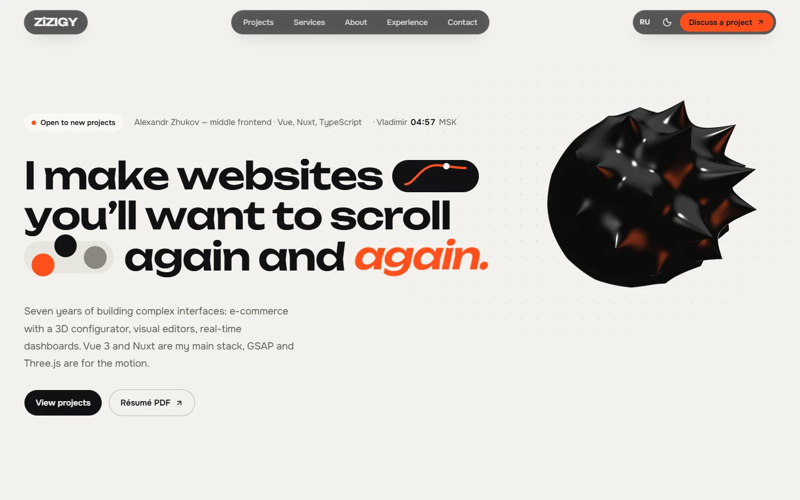
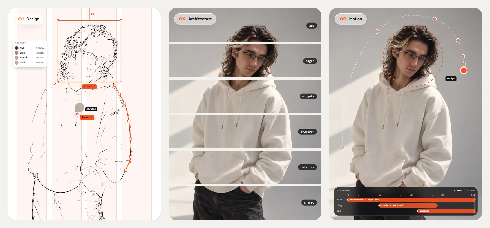
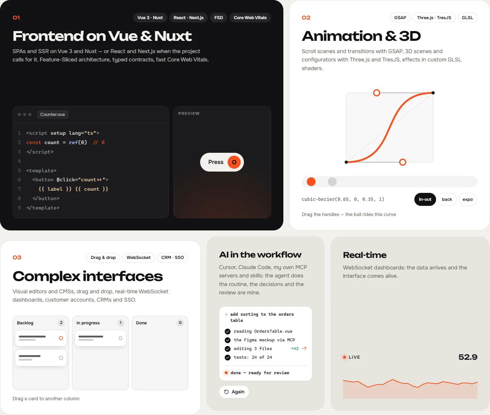
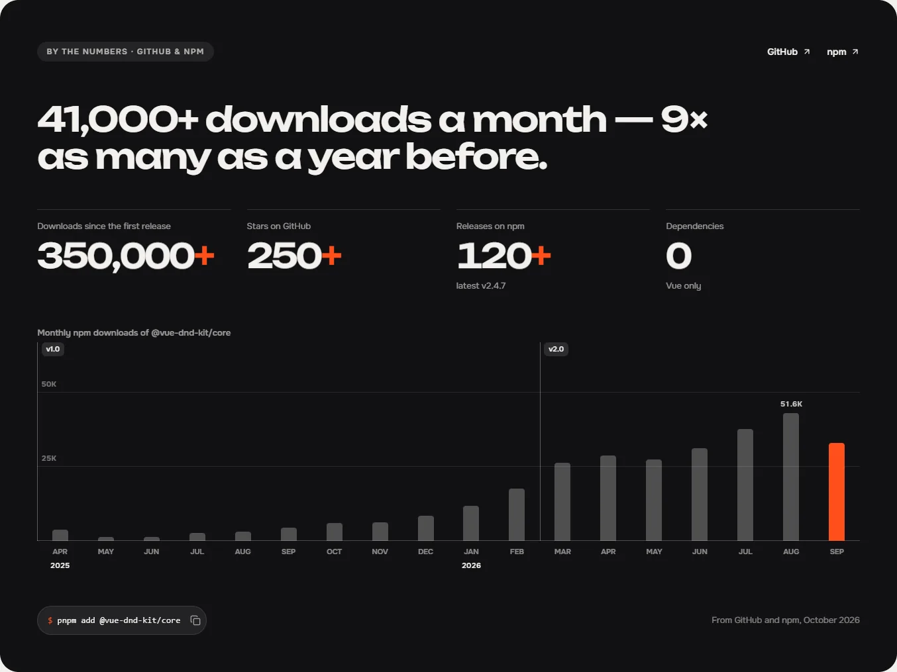
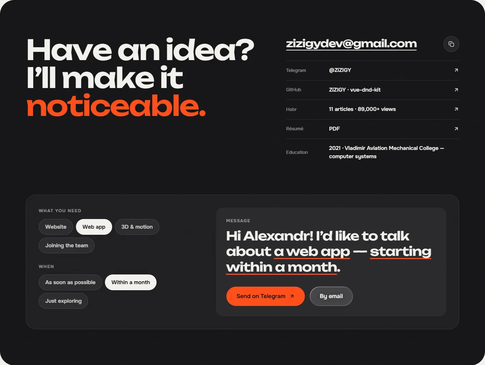

<div align="center">

<a href="https://zizigy.github.io/ZiZIGY/">
  <picture>
    <source media="(prefers-color-scheme: dark)" srcset=".github/readme/hero-dark.webp">
    
  </picture>
</a>

# Alexandr Zhukov · ZiZIGY

**Middle frontend developer: Vue, Nuxt, TypeScript.**<br>
I design what I build, so nothing gets lost between the mockup and the code.

<a href="https://zizigy.github.io/ZiZIGY/"></a>
<a href="https://t.me/ZiZIGY"></a>
<a href="mailto:zizigydev@gmail.com"></a>
<a href="https://habr.com/ru/users/ZiZIGY/articles/"></a>
<a href="https://zizigy.github.io/ZiZIGY/resume.pdf"></a>


</div>

## 👋 About me

- 🧑‍💻 **7 years** in commercial frontend, since 2019: e-commerce with a 3D configurator, visual editors, drag and drop, real-time dashboards, CRMs and SSO
- 🎨 I design and I build: spacing, rhythm and motion reach production exactly as intended
- 🧱 Architecture that grows: Feature-Sliced Design, typed contracts, shared component foundations
- ✨ Motion with a purpose: GSAP, Three.js / TresJS and custom GLSL shaders
- 🤝 I make architecture calls, hire and mentor developers
- 🤖 AI in the workflow: Cursor, Claude Code, my own MCP servers and skills
- 📍 Vladimir, Russia · UTC+3 · **open to new projects**

## 🛠️ Stack

<p align="center">
  <br>
  
</p>

<p align="center"><sub>plus GSAP, TresJS, GLSL, shadcn-vue, VueUse, Valibot, WebSocket</sub></p>

## ✦ Selected work

| | Project | What it is |
|:-:|---|---|
| 🧲 | **[vue-dnd-kit](https://github.com/ZiZIGY/vue-dnd-kit)** | Headless drag and drop for Vue 3 and TypeScript: composables, multi-drag, nested zones, keyboard, auto-scroll, zero dependencies. **250+ ★ · 41,000+ npm downloads a month · 350,000+ in total** |
| 🔥 | **[Wispbringer](https://zizigy.github.io/WispbringerDemo/)** | A survivors-like on my own engine: rendered with Three.js, every visual effect is a custom GLSL shader. [Play the demo](https://zizigy.github.io/WispbringerDemo/) |
| ✂️ | **[SpriteCutter](https://zizigy.github.io/SpriteCutter/)** | Cuts sprite sheets automatically, including AI-generated ones, where standard algorithms get it wrong. [Try it](https://zizigy.github.io/SpriteCutter/) |
| 🕹️ | **Game engine** | A desktop editor (Electron + Nuxt) that builds browser games for web and desktop, with a built-in AI agent that knows the engine’s API. Closed for now |

## 💼 Experience

| When | Where | Highlights |
|---|---|---|
| 2025 – now | **Ventra** · client: Akrikhin | SSO frontend from scratch on Nuxt 4 + shadcn-vue; accounts, admin panels and CRMs for pharma (a pharmacy network of 2,000+ users); a component and form foundation for the whole team |
| 2023 – 2025 | **Bintaga Home** | E-commerce migration from 1C-Bitrix to Nuxt 3 + Go: 50,000+ products, pages 40% faster; a 3D configurator on TresJS with 100+ options; hired two developers, mentored two juniors |
| 2022 – 2023 | **ElRos** | A regional education system from scratch: UI, REST API, PHP backend, database; 15+ Vue and 20+ Bitrix components |
| 2019 – 2022 | **Systems & Technologies Group** | A real-time WebSocket dashboard for 50+ energy meters; typed a legacy API and documented 8 device types |

## ✍️ Writing

**[11 articles on Habr](https://habr.com/ru/users/ZiZIGY/articles/) · 89,000+ views**, on Vue and Nuxt, drag and drop, CSS architecture and frontend inside Bitrix. The most read: [the world’s first Web Components library in the spirit of shadcn](https://habr.com/ru/articles/972038/) (in Russian).

## 📊 GitHub stats

<div align="center">
  <br>
  
  
</div>

---

## 🌐 This repository: the portfolio

The source of **[zizigy.github.io/ZiZIGY](https://zizigy.github.io/ZiZIGY/)**: one page, a case page per project, English and Russian, light and dark, and motion locked to the scroll. Designed and coded by me.

<p align="center">
  
  <br><sub><b>About</b>: the portrait turns into a picture of each principle as you read. First a design file (a pen path fitted to the outline, an eyedropper, colour styles sampled from the photo), then six Feature-Sliced layers assembling, then a timeline driving a real animation.</sub>
</p>

<table>
  <tr>
    <td width="50%"></td>
    <td width="50%"></td>
  </tr>
  <tr>
    <td><sub><b>Services</b>: tiles you can play with. A real Vue counter next to its source, an easing editor with draggable bezier handles, a working kanban, an AI agent at work, a live chart.</sub></td>
    <td><sub><b>vue-dnd-kit</b>: the library’s numbers on its case page: downloads by month since the first release, with markers where each major version shipped.</sub></td>
  </tr>
  <tr>
    <td colspan="2"></td>
  </tr>
  <tr>
    <td colspan="2"><sub><b>Contact</b>: pick what you need and when; the sentence writes itself and opens in Telegram or your mail app already typed.</sub></td>
  </tr>
</table>

### What’s inside

- **Hero**: a drop of ferrofluid ray-marched in a fragment shader (plain WebGL). The pointer is its magnet, and spikes rise towards it.
- **Showreel**: a strip of film run by the scroll; every frame is CSS reading one variable.
- **Projects**: sticky stacked cards with a progressive blur over the screenshots; a card morphs into its case page with a View Transition.
- **About**: the chaptered portrait above, a tools jar with real physics (matter-js).
- **Experience**: an editorial timeline; the year rolls like an odometer.
- **A custom cursor**, liquid glass in tiers, and every animation paused while it’s off screen.

| | |
|---|---|
| Framework | Nuxt 4 · Vue 3.5 · TypeScript |
| Styling | Tailwind CSS v4 · Sass · shadcn-vue (Reka UI) |
| Motion | GSAP (ScrollTrigger, SplitText) · Lenis · motion-v · View Transitions API · raw WebGL · matter-js |
| State & data | Pinia · VueUse · @nuxtjs/i18n (EN / RU) |
| Hosting | Static generation · GitHub Pages via GitHub Actions |

### Run it

```bash
pnpm install
pnpm dev          # http://localhost:3000
pnpm generate     # the static site, in .output/public
pnpm lint
pnpm typecheck
```

### Deploy

Every push to `main` builds and publishes the site with [`.github/workflows/deploy.yml`](.github/workflows/deploy.yml). It generates static HTML and serves it under the repository’s path (`/ZiZIGY/`); with a custom domain the base becomes `/` on its own. Set it up once: **Settings → Pages → Build and deployment → Source: GitHub Actions**.

<details>
<summary><b>Project structure and conventions</b></summary>

<br>

```
app/
  components/home/       one component per section of the page
  components/project/    project cards and the case-page blocks
  components/fx/         reusable motion: Reveal, Magnetic, Odometer, Ferrofluid, LiveClock…
  components/app/        header, menu, cursor, preloader, footer, to-top
  composables/           useGsap, useSectionNav, useSectionSpy, useProjectCase…
  data/                  site details, projects, experience, the library's numbers
  pages/                 / and one page per project: /projects/<slug>.vue
i18n/locales/            en.json, ru.json: every piece of copy
public/images/           the photo and the screenshots, exported to avif/webp
```

- **Content** lives in `app/data/*.ts` (links, numbers, work history) and `i18n/locales/*.json` (all copy). The vue-dnd-kit and Habr figures are typed in by hand; nothing is fetched at runtime.
- **Scroll animations** go through `useGsap(setup, scope)`: scoped selectors, `{ isDesktop, isMobile, reduceMotion }`, and everything reverts on unmount.
- **Split text** with `<FxReveal>`, or SplitText inside `useGsap(…, { deps: locale })`, so the split is redone after a language switch.
- **Display type** has negative letter-spacing, so every mask that clips it (word masks, odometer columns) gets padding on all sides.
- **Files from `public/`** are linked with `withBase('/images/…')`, so they resolve under the GitHub Pages path.
- **Never use a sticky element as a ScrollTrigger trigger**: it reports its stuck position, so start/end drift.
- **Performance**: CSS loops pause off screen (`v-pause-offscreen`); no blend modes on large layers; glass with SVG refraction only on a few small, slow pieces.
- **Static i18n**: the generated HTML is English; a Russian browser switches to Russian on load, behind the preloader.

</details>

<p align="center"><sub>Design and code by me · © 2026 Alexandr Zhukov</sub></p>
